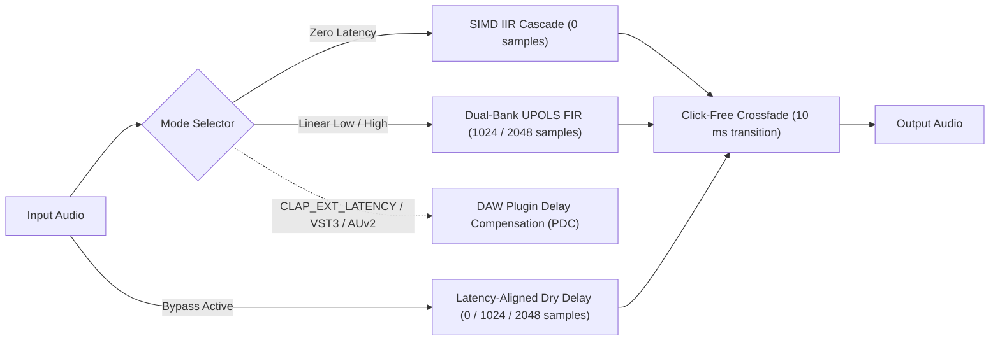

# Equaform-8


Real-time 8-band parametric equalizer written in Rust, available as **DAW plugins (`CLAP`, `VST3`, `AUv2`)** on macOS and **DAW plugins (`CLAP`, `VST3`)** on Windows x64, plus a **native macOS standalone application** (`Equaform-8.app` with CoreAudio HAL virtual driver) and an offline CLI processor.

## Platform Support Matrix

| Target | macOS (Apple Silicon / Intel) | Windows (x64) |
| :--- | :---: | :---: |
| **CLAP Plugin** | Yes (`Equaform-8.clap`) | Yes (`Equaform-8.clap`) |
| **VST3 Plugin** | Yes (`Equaform-8.vst3`) | Yes (`Equaform-8.vst3`) |
| **AUv2 Plugin** | Yes (`Equaform-8.component`) | N/A |
| **Standalone App** | Yes (`Equaform-8.app` + `Equaform.driver`) | **No (Plugins only)** |
| **Release Deliverable** | `Equaform-8-vX.Y.Z.dmg` (Plugins + Standalone) | `Equaform-8-Plugins-Windows-vX.Y.Z.exe` (Plugins only) |

> **Windows Scope Note:** Windows releases intentionally ship **DAW plugins only (`VST3` and `CLAP`)** with the 15 factory presets. The standalone system-wide application is **macOS-only** because it relies on the native CoreAudio HAL virtual driver (`driver/equaform-hal`).

## Implemented Targets & Features

- **DAW Plugins (`CLAP`, `VST3`, `AUv2`)**
  - Native **CLAP** implementation in `crates/equaform-plugin` with embedded **macOS Cocoa (`NSView`) + Metal** and **Windows Win32 (`HWND`) + DirectX 12 / Vulkan** editors (`wgpu` / `egui-wgpu`, `1180×560`).
  - **VST3** (Ableton Live, Cubase, Reaper, Bitwig, FL Studio) on macOS & Windows, and **Audio Unit v2** (`aufx` / `Eqf8` / `Eqfm` for Logic Pro, GarageBand, MainStage) on macOS, generated via `clap-wrapper`.
  - **61 automatable parameters** (8 bands × Active/Type/Frequency/Gain/Q/Slope/Routing + Global Gain, Output Trim, Bypass, Auto-Gain, Auto-Gain Mode, Processing Mode) with sample-accurate sub-block automation, Touch/Latch UI gestures, text value parsing, and versioned CRC32 binary + JSON state persistence.
- **Standalone macOS Application (`Equaform-8.app` — macOS only)**
  - System-wide EQ powered by a native C11 CoreAudio `AudioServerPlugIn` virtual audio driver (`driver/equaform-hal`) and drift-compensated CoreAudio playback.
- **CLI / Offline Renderer (`equaform-cli`)**
  - Offline WAV processing and diagnostics using the shared DSP engine.
- **DSP, Analysis & Shared UI (`equaform-gui`)**
  - 8-band EQ (`Bell`, `LowShelf`, `HiShelf`, `HiPass`, `LowPass`; 6/12/18/24 dB/oct slopes) with selectable **Zero Latency** (minimum-phase SIMD IIR) and **Linear Phase** (`Linear Low` / `Linear High` UPOLS FIR) processing modes, dual-mode Auto-Gain (**Perceptual** loudness match & musical **Anti-Clip** headroom protection), per-band **Stereo / Left / Right / Mid / Side** routing, monitor-only **Band Solo** audition, instant **A/B Compare** (`A / B / A>B`), bounded **Undo/Redo** (`Cmd/Ctrl+Z`, `Cmd/Ctrl+Shift+Z` / `Ctrl+Y`), `[-40 dB .. +40 dB]` response curve plot (dirty-flag cached), real-time FFT spectrum analyzer, stereo L/R VU-meter, and native zero-allocation i18n (`EN` / `FR` / `DE` / `ES`).
  - Lock-free audio hot path (`ADR-007`: zero allocation, non-blocking ring buffers & atomic snapshots).
  - **15 factory presets** and user presets (sorted with user presets first and factory presets alphabetically) synchronized across standalone and plugins (`~/.equaform/presets/*.req` on macOS, `%APPDATA%\Equaform\presets\*.req` on Windows).

## Processing Modes (Zero Latency vs Linear Phase — v1.3.0)

Equaform-8 provides three real-time processing modes so you can trade zero algorithmic latency for phase-coherent filtering depending on the mixing or mastering stage:

| Mode | Topology | Latency (@ 48 kHz) | Phase & Transient Character | Best For |
| :--- | :--- | :---: | :--- | :--- |
| **`Zero Latency`** | Minimum-phase SIMD IIR biquad cascade | `0` samples (`0.0 ms`) | Analog-style phase shift, zero pre-ringing, minimal CPU | Live tracking/monitoring, individual tracks, dry/punchy percussion |
| **`Linear Low`** | Linear-phase FIR (`2048` taps, UPOLS) | `1024` samples (`≈ 21.3 ms`) | Zero relative phase shift across all frequencies (constant group delay); auto-compensated via DAW PDC (`CLAP_EXT_LATENCY` / VST3 / AUv2) | Parallel bus processing (no comb filtering), multi-mic drums/overheads, general mixing |
| **`Linear High`** | Linear-phase FIR (`4096` taps, UPOLS) | `2048` samples (`≈ 42.7 ms`) | Double low-frequency resolution (`20–60 Hz` sub-bass & steep `24 dB/oct` slopes); auto-compensated via DAW PDC | Mastering and critical sub-bass sculpting |

### Signal Flow & Seamless Transitions



- **Latency-Aligned Bypass**: When **Bypass** is engaged in `Linear Low` or `Linear High`, the dry signal passes through a matching sample delay (`1024` or `2048` samples) so toggling Bypass never introduces timing jumps or comb filtering against DAW PDC.
- **Click-Free Mode & Parameter Updates**: Linear-phase EQ changes crossfade between dual pre-allocated UPOLS filter banks, and switching between `Zero Latency`, `Linear Low`, and `Linear High` uses a smooth `10 ms` transition without clicks or audio-thread allocations.

## Future Scope

- Dynamic EQ and oversampling
- Linux packaging for `CLAP` / `VST3` plugins
- Audio Unit v3 (`AUv3`) and multichannel support

## Repository Layout

```text
crates/
  equaform-common/             Shared types, parameter IDs, lock-free rings, state schema
  equaform-dsp/                Biquads, coefficients, smoothing, and EQ processing
  equaform-engine/             Real-time engine lifecycle and parameter transport
  equaform-analysis/           Lock-free FFT spectrum and VU metering
  equaform-gui/                Shared egui workspace UI (`workspace_ui`) and preset I/O
  equaform-plugin/             CLAP plugin implementation + Cocoa/Metal plugin editor
  equaform-standalone/         macOS standalone desktop application
  equaform-cli/                Offline WAV renderer and diagnostics
  equaform-integration-tests/  Cross-layer and integration tests

driver/
  equaform-hal/                Native C11 CoreAudio AudioServerPlugIn virtual driver
  clap-wrapper/                Vendored clap-wrapper 0.17.0 (VST3 & AUv2 wrapper)
  clap-wrapper-equaform/       CMake build configuration for Equaform VST3 & AUv2 bundles

scripts/
  build-driver.sh              Builds universal binary CoreAudio HAL driver
  package-macos-app.sh         Packages Equaform-8.app (standalone)
  package-macos-plugins.sh     Builds, inside-out signs, and installs CLAP, VST3 & AUv2

docs/
  architecture/                Architecture, system schema, and design specs
  decisions/                   Architecture Decision Records (ADRs)
  branding/                    Brand identity and positioning specs
  agent/                       Project handoff notes (`HANDOFF.md`)
```

## Building & Installing on macOS

### DAW Plugins (`CLAP`, `VST3`, `AUv2`)

Requires Rust toolchain, CMake (`>= 3.22`), Ninja, and Xcode Command Line Tools:

```bash
./scripts/package-macos-plugins.sh
```

This builds `libequaform_plugin.dylib`, wraps it into `Equaform-8.clap`, `Equaform-8.vst3`, and `Equaform-8.component`, performs inside-out ad-hoc codesigning, refreshes `AudioComponentRegistrar`, and installs them to:

- `~/Library/Audio/Plug-Ins/CLAP/Equaform-8.clap`
- `~/Library/Audio/Plug-Ins/VST3/Equaform-8.vst3`
- `~/Library/Audio/Plug-Ins/Components/Equaform-8.component`

Verify the Audio Unit registration with Apple's validator:

```bash
auval -v aufx Eqf8 Eqfm
```

### Standalone Application (`Equaform-8.app` — macOS only)

```bash
./scripts/package-macos-app.sh
```

### Combined Distribution DMG (Plugins + Standalone)

```bash
./scripts/package-distribution-plugins.sh 1.3.0
```

This generates `target/release/dist/Equaform-8-v1.3.0.dmg` (and its `.sha256` checksum) containing both the DAW plugins installer (`Equaform-8-Plugins-Installer.pkg` for `AUv2`, `VST3`, `CLAP`, and presets) and the standalone `Equaform-8.app` bundle.

## Real-Time Contract

The audio hot path must remain:

- allocation-free;
- non-blocking;
- I/O-free;
- syscall-free;
- panic-free by contract;
- deterministic within documented numerical tolerances.

## Local Validation

```bash
cargo test --workspace
cargo clippy --workspace -- -D warnings
auval -v aufx Eqf8 Eqfm
```

## License & Trademarks

- Distributed under either of [Apache License, Version 2.0](LICENSE-APACHE) or [MIT License](LICENSE-MIT) at your option.
- VST is a registered trademark of Steinberg Media Technologies GmbH.

