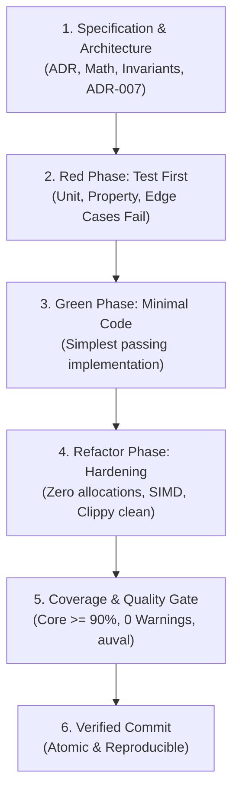

# Spec-Driven TDD Methodology (Test-Driven Development)

**Equaform Audio Engineering Standards**  
**Version:** 1.0.0  
**Scope:** All workspace crates (`crates/`) and native plugins (`driver/`)

---

## 1. Core Philosophy

In high-performance professional audio software, **correctness, determinism, and real-time safety are non-negotiable**. Bugs in audio processing result in audible clicks, audio dropouts, distortion, host DAW crashes, or loud transients that can damage hearing and monitors.

Therefore, **all new development, feature enhancements, and bug fixes must follow the Spec-Driven TDD Protocol**:



> [!IMPORTANT]
> **Rule #1 of Development in Equaform:**  
> Never write production code before writing its corresponding failing test based on an approved architectural specification.

---

## 2. The 5-Phase Development Lifecycle

### Phase 1: Specification & Architecture Invariants
Before opening any Rust source file:
1. **Define the Behavioral Contract**: What are the inputs, outputs, mathematical domain, sampling rates, and block sizes?
2. **Enforce Real-Time Invariants (ADR-007)**:
   - Does this code run on the real-time audio thread?
   - If **YES**: It must guarantee **zero heap allocations**, **zero mutex locks**, **zero blocking syscalls**, and **zero synchronous I/O**.
3. **Formulate Numerical Invariants**:
   - Frequency bounds: $[20.0\text{ Hz} .. 20{,}000.0\text{ Hz}]$.
   - Quality factor $Q$: $[0.1 .. 20.0]$.
   - Gain bounds: $[-24.0\text{ dB} .. +24.0\text{ dB}]$.
   - Filter stability: Poles must remain strictly within the unit circle $|z| < 1$.
   - Output bound: Peak gain compensation must not overflow standard IEEE-754 single-precision float dynamic range.

---

### Phase 2: RED Phase (Write Failing Tests First)
Write exhaustive tests in `tests/` or module-level `#[cfg(test)] mod tests` **before** writing the feature:
1. **Nominal Case**: Expected output given standard inputs (e.g. 1 kHz sine at -6 dBFS).
2. **Boundary / Edge Cases**:
   - Nyquist frequency ($f_s / 2$) and DC ($0\text{ Hz}$).
   - Extremely high and low $Q$ factors.
   - Zero or maximum block sizes (e.g. 0, 1, 64, 512, 4096 samples).
   - Audio silence ($-\infty\text{ dBFS}$) and white noise.
3. **Real-Time Property & Allocation Tests**:
   - Ensure structures are pre-allocated (`Vec::with_capacity` or static arrays `[T; N]`).
   - Use buffer handoff or slice processing (`&mut [f32]`) without intermediate vectors.
4. **Execution**: Verify that `cargo test -p <crate> <test_name>` fails as expected (compilation error or assertion failure).

---

### Phase 3: GREEN Phase (Minimal Conforming Implementation)
Implement the minimum code necessary to make the failing test pass:
- Adhere strictly to the defined API contract.
- Do not anticipate unrequested features or over-engineer abstractions.
- Verify: `cargo test -p <crate> <test_name>` passes cleanly.

---

### Phase 4: REFACTOR Phase (Optimization & Hardening)
Refactor the code while keeping tests green:
1. **Eliminate Temporary Allocations**: Replace any dynamic heap vectors with slice borrowing (`process_ref`, `process_into`, fixed ring buffers).
2. **Numerical & SIMD Optimization**: Ensure loops are autovectorizable by LLVM (contiguous slices, non-aliasing pointers).
3. **Static Analysis & Linting**:
   ```bash
   cargo clippy --workspace --all-targets -- -D warnings
   cargo fmt --all -- --check
   ```
4. **Regression Testing**: Run the full test suite to guarantee zero regression:
   ```bash
   cargo test --workspace --all-features
   ```

---

### Phase 5: Verification & Coverage Gate
Verify the implementation against repository thresholds:
1. **Coverage Check**:
   ```bash
   cargo llvm-cov -p equaform-common -p equaform-dsp -p equaform-analysis -p equaform-engine --fail-under-lines 90 --summary-only
   ```
   - Core crates (`equaform-common`, `equaform-dsp`, `equaform-engine`, `equaform-analysis`) must maintain **$\ge 90\%$ line coverage**.
2. **Plugin Verification (macOS)**:
   ```bash
   auval -v aufx Eqf8 Eqfm
   ```
   - Must output `AU VALIDATION SUCCEEDED`.

---

## 3. Testing Pyramid in Equaform-8

| Level | Scope | Example | Target Coverage |
| :--- | :--- | :--- | :---: |
| **Unit Tests** | Pure functions, biquad coefficients, math | `test_biquad_peaking_symmetry` | **> 95 %** |
| **Property Tests** | Parameter bounds, roundtrips, state serde | `test_all_51_params_round_trip` | **> 90 %** |
| **Concurrency Tests**| Triple buffer, ring buffer, wait-free ops | `test_realtime_threaded_streaming` | **> 95 %** |
| **Audio Fixture Tests**| Sine waves, impulse response, silence | `test_split_block_equivalence` | **> 90 %** |
| **Lifecycle Tests** | Prepare, process, reset, block-size change | `test_engine_lifecycle_sequence` | **> 90 %** |
| **DAW Host Tests** | CLAP / VST3 / AUv2 instantiation, auval | `auval -v aufx Eqf8 Eqfm` | **100 % pass** |

---

## 4. TDD Checklist for Pull Requests & Commits

- [ ] Architectural requirement or ADR identified and documented.
- [ ] Real-time safety verified: no allocations, no locks, no blocking calls on audio path.
- [ ] Tests written **before** production code (Red phase validated).
- [ ] Nominal, edge, and boundary cases covered.
- [ ] Implementation passes all tests (Green phase).
- [ ] Code refactored, formatted (`cargo fmt`), zero Clippy warnings (`-D warnings`).
- [ ] Core crate test coverage verified $\ge 90\%$ (`cargo llvm-cov`).
- [ ] CI pipeline validated across Linux, macOS, and Windows.
